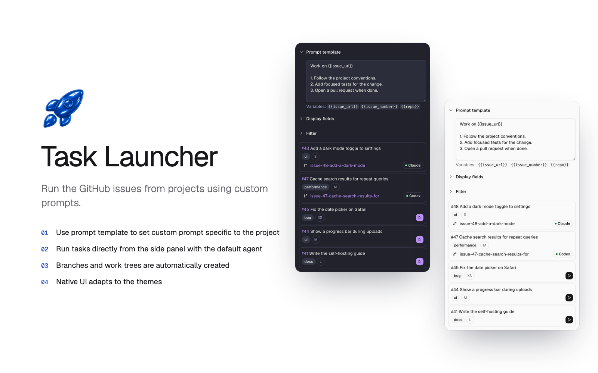

# Task Launcher

Turn GitHub issues into active coding sessions, right from Orca’s sidebar. Choose an issue,
give your agent a prompt, and start working in a dedicated branch and worktree.



## Features

- **Browse issues in Orca.** See open GitHub issues for your selected project without switching apps.
- **Start work with one click.** Launch your default coding agent in a dedicated branch and worktree linked to the issue.
- **Make prompts your own.** Save a separate prompt template for each project to guide how your agent approaches the work.
- **Find what matters.** Filter by status, assignee, label, milestone, author, or issue type.
- **Keep track of progress.** See linked worktrees and running agents, and jump back into ongoing work.
- **Bring in GitHub Projects.** Choose which available board fields appear alongside your issues.

## Get started

Requires **Orca 1.4.248+**, the Orca CLI, and **GitHub CLI (`gh`)** signed in with access to your repository.

```sh
orca plugin install rr235/orca-task-launcher
```

Review the requested access, then run the approval command Orca provides. On Linux, use
`orca-ide` instead of `orca`.

Once installed:

1. Select a GitHub project in Orca’s sidebar.
2. Open **Task Launcher**, the rocket panel.
3. Set your prompt template and click **Start** on an issue.

Your agent receives the prompt and starts in the linked worktree.

## Your prompt, every time

Templates save automatically for each project. Start with `Complete {{issue_url}}`, or add
your own instructions:

```text
Work on {{issue_url}}.
Follow the repository instructions, run the relevant checks,
and summarize your changes.
```

| Variable | Value |
| --- | --- |
| `{{issue_url}}` | Link to the issue |
| `{{issue_number}}` | Issue number |
| `{{repo}}` | Repository as `owner/name` |

## GitHub Projects

Board fields and status filtering are available when your account can read the project board.
To enable access:

```sh
gh auth refresh -s read:project
```

You can browse and launch issues without a project board.

## Development

```sh
orca plugin validate .
orca plugin test .
orca plugin check .
orca plugin dev watch .
```

## License

[MIT](LICENSE)
